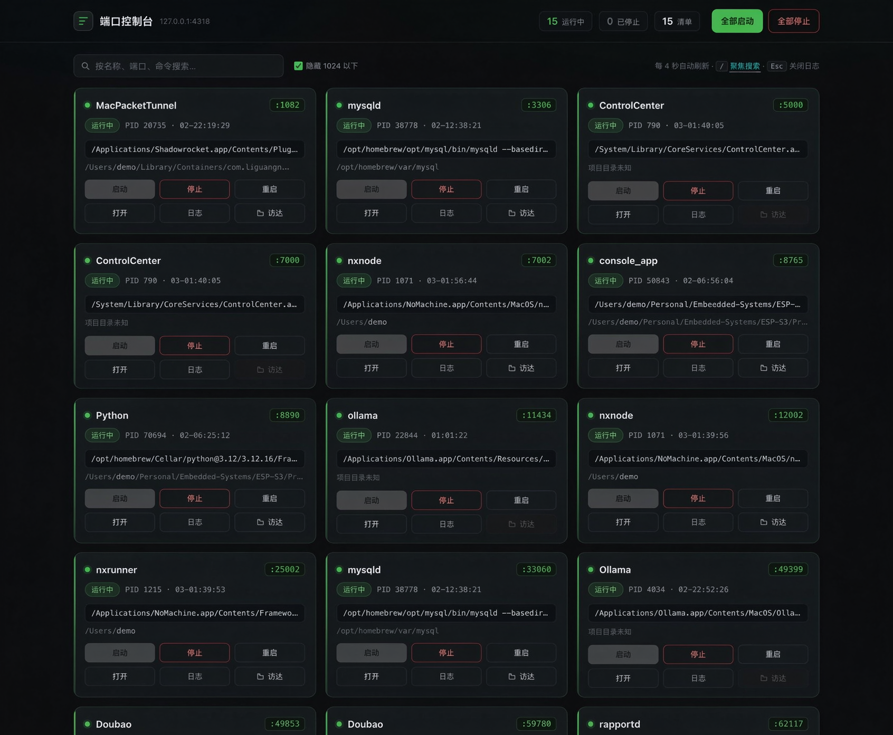

# 端口控制台（PortConsole）

本机所有正在监听的 TCP 端口自动成为清单成员，网页上点按钮即可启动 / 停止 / 重启 / 看日志，每张卡还能直接在访达里打开对应项目文件夹。

- 不用点「加入清单」，扫描到的端口默认全部在清单里
- 零第三方依赖，只用 Node 内置模块
- 只监听 `127.0.0.1`，不对外网暴露
- 关掉控制台，已启动的服务继续在后台跑



## 下载安装（macOS）

到 [Releases](../../releases) 下载 `PortConsole-macOS-<版本>.zip`，解压后把 `PortConsole.app` 拖进「应用程序」。

- 需要本机已有 **Node.js 18+**（应用调用系统 node；`brew install node` 或从 nodejs.org 安装）
- 应用没有做 Apple 公证，首次打开请**右键 → 打开**；如果提示「已损坏」，执行一次：
  ```bash
  xattr -dr com.apple.quarantine /Applications/PortConsole.app
  ```
- 双击后会拉起本地服务并打开默认浏览器；重复双击只会打开已有页面，不会起第二个实例
- 数据在 `~/Library/Application Support/PortConsole/`（`services.json`、`logs/`、`console.log`），卸载应用不会删数据

## 快速开始（源码运行）

```bash
cd ~/Personal/PortConsole
node server.mjs
# 或直接双击「启动.command」
```

打开 <http://127.0.0.1:4318>。

## 打包 .app

```bash
./build-app.sh
# 产物：dist/PortConsole.app 与 dist/PortConsole-macOS-<版本>.zip
```

版本号写在 `VERSION`，图标是 `assets/icon-1024.png`。

## 清单是怎么来的

打开控制台后，`lsof` 扫到的每个监听端口都会自动写进 `services.json`，id 固定为 `auto-<端口>`：

- **新增**：新出现的端口直接建条目，命令、工作目录、可访问地址都从进程本身取
- **跟随**：同一个端口换了进程（命令或目录变了），`auto` 条目自动更新，卡片跟着变
- **换端口复用**：同一个程序换了个端口（命令里只有端口号不同也算，`rapportd`、`llama-server` 这类会重新绑端口的进程都适用），旧条目直接改到新端口，不会多出一张死卡
- **保留**：端口停了，条目仍在，卡片变成「已停止」，可以直接再启动
- **清理**：`auto` 条目连续 7 天没再监听就自动删掉；同命令已换端口的旧条目立即清理；`auto` 条目总数上限 80，超出先丢最久没出现的
- **不覆盖手工配置**：自己写的条目（没有 `auto` 字段）永远不会被自动逻辑改动

因此**正在监听的端口没法从界面上移出清单**——删掉条目，下一轮扫描还会加回来。这是「全部默认在清单内」的直接代价。不想让某个端口出现，只能靠搜索过滤，或先停掉那个进程。

想固定某个服务的名字、启动命令或 id，把它的 `auto` 条目改成手工条目即可：删掉 `"auto": true`（以及 `addedAt` / `lastSeen`），之后自动逻辑不再碰它。

## 改配置

`services.json` 里每个 `services` 元素就是一张卡片：

```json
{
  "services": [
    {
      "id": "api",
      "name": "后端 API",
      "port": 8000,
      "cwd": "~/code/backend",
      "command": "npm run dev",
      "url": "http://localhost:8000",
      "note": "依赖本地 Postgres",
      "env": { "NODE_ENV": "development" },
      "startTimeout": 25000
    }
  ]
}
```

| 字段 | 必填 | 说明 |
| --- | --- | --- |
| `id` | 是 | 唯一标识，只用英文/数字/短横线，日志文件名也用它 |
| `name` | 是 | 界面上显示的名字 |
| `port` | 是 | 服务监听的端口，状态判定就看这个端口 |
| `command` | 是 | 启动命令，用 `/bin/zsh -lc` 执行，因此能读到 nvm / Homebrew 的 PATH |
| `cwd` | 否 | 工作目录，支持 `~` 和相对路径（相对本目录）。自动条目拿不到目录时为 `null`，启动时退回本目录 |
| `url` | 否 | 「打开」按钮跳转的地址，默认 `http://localhost:<port>` |
| `note` | 否 | 卡片上的一行备注 |
| `env` | 否 | 追加的环境变量 |
| `startTimeout` | 否 | 启动后等待端口就绪的毫秒数，默认 25000 |
| `auto` | 否 | `true` 表示这条是扫描自动纳入的，会被自动更新和清理；不写就是手工条目 |

改完保存，网页 4 秒内自动同步，不需要重启后端。

## 卡片与操作

每张卡固定 6 个按钮：

| 按钮 | 作用 | 置灰条件 |
| --- | --- | --- |
| 启动 | 按 `command` 在 `cwd` 下起进程，等端口就绪 | 已在运行 |
| 停止 | 结束占用该端口的进程 | 未运行 |
| 重启 | 先停再启 | 未运行 |
| 打开 | 浏览器打开 `url` | 未运行 |
| 日志 | 打开 `logs/<id>.log` 抽屉，1.5 秒刷新 | 无 |
| 访达 | 在访达打开项目文件夹 | 拿不到项目目录 |

**访达的目录来源**：配置里的 `cwd` → 进程真实 cwd → 从命令行里的项目路径向上找项目标记（`.git` / `package.json` / `Cargo.toml` / `platformio.ini` / `CMakeLists.txt` / `*.xcodeproj` 等）推断出的项目根。系统进程（`ControlCenter`、`rapportd`、`ollama`、`Doubao` 等）通常拿不到，按钮置灰并显示「项目目录未知」。

**过滤**：默认隐藏 1024 以下系统端口；顶部搜索框按名称、端口、命令、目录过滤所有卡片。

## 全部启动 / 全部停止

- **全部启动**只处理当前没在跑的条目，已在监听的全部跳过；没有可启动的会直接提示
- **全部停止**只处理当前在跑的条目，会先弹确认框，并明确告知会连系统进程一起停
- 某个失败不影响其余，最后汇总成功数、失败原因

## 行为说明

- **状态**：每 4 秒用 `lsof` 查一次端口是否有 LISTEN，端口在监听就算「运行中」，同时显示 PID 和已运行时长。
- **启动**：先检查端口是否被占；被占就直接报错并给出占用 PID，不会盲目拉起。启动后轮询端口，就绪才返回成功，最长等 `startTimeout`。
- **停止**：只结束占用该端口的监听进程。只有本控制台自己拉起的进程（独立进程组，pgid = 子进程 pid）才会整组 SIGTERM，其余一律单进程 SIGTERM，6 秒不退再 SIGKILL——扫描来的系统进程绝不会连带杀掉 launchd 或别的进程组。
- **日志**：`logs/<id>.log`，按时间追加。界面里点「日志」打开抽屉；也可以用 `?log=<id>` 直接打开某个服务的日志。
- **关掉控制台**：只退出 node 进程，已启动的服务不受影响。

## 快捷键

| 键 | 作用 |
| --- | --- |
| `/` | 聚焦搜索框 |
| `Esc` | 关闭日志抽屉 / 让搜索框失焦 |

## 限制与注意

- 只在 macOS 上实测过（依赖 `lsof`、`ps`、`/bin/zsh`）。Linux 上理论可用，但要确认 `lsof` 已安装。
- 只服务非容器场景；Docker 容器请用 `docker compose` 自己管，别在这里绕。
- 后端**没有鉴权**，绑的是 `127.0.0.1`。不要改成 `0.0.0.0` 或挂到公网。
- 接口只接受 `services.json` 里的 `id`，不接受任意命令，避免网页端变成任意命令执行入口。
- 系统进程（`ControlCenter`、`rapportd`、`ollama` 等）可能因权限不足停不掉，或重启后行为异常，会给出明确错误。
- 状态靠「端口是否在监听」判断，所以一个启动成功但没绑端口的进程会被算作「已停止」，需要看日志排查。
- 自动条目会随扫描写回 `services.json`；如果你同时手工编辑这个文件，保存后 4 秒内可能被自动更新覆盖 `auto` 条目，手工条目不受影响。

## 目录结构

```
PortConsole/
├── server.mjs              后端：状态探测 + 启停 + 自动纳入 + 日志接口
├── public/index.html       前端：单文件，内联 CSS/JS
├── packaging/launcher.sh   .app 启动器（拉起服务 + 打开浏览器）
├── build-app.sh            打 .app / zip 的脚本
├── VERSION                 版本号
├── assets/icon-1024.png    应用图标源图
├── services.json           服务清单（运行后生成，已 gitignore）
├── 启动.command             双击即可跑源码
├── logs/                   每个服务一份日志（自动创建）
└── docs/                   界面截图
```

## 常见问题

**换控制台自己的端口**

```bash
PORT=4319 node server.mjs
```

**启动后立刻退出**

看 `logs/<id>.log`。多数是命令写错、依赖没装、或 `cwd` 不对。自动条目拿不到目录时会退回本目录，命令里最好写绝对路径。

**端口被别的程序占着，但我想强抢**

先在卡片上点「停止」把它收掉，再点「启动」。系统级进程可能因权限失败，会明确提示。

**某个端口不想出现在界面里**

停掉那个进程，或者用搜索框过滤。直接删 `services.json` 条目没用——只要它还在监听，下一轮扫描就会重新加回来。
